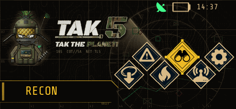

# PagerTAKTheme – TAK5 theme for the [WiFi Pineapple Pager](https://hak5.org/products/wifi-pineapple-pager)

Community themes and ringtones for the Hak5 WiFi Pineapple Pager by SECT0101.

| Theme | Description |
|---|---|
| [TAK5](themes/tak5) | Tactical TAK theme in coyote tan with a hacker-movie edge: the TAK.5 wordmark, Tac-Pine the pineapple operator mascot, a TAK THE PLANET! boot finale and [matching ringtones](ringtones/tak5) |

## Layout

- **`themes/<name>/`** is the installable theme. Copy the folder to `/root/themes/` on the Pager, then pick it under **Settings > Display > Theme**.
- **`art/<name>/`** holds full-size logos and characters as transparent PNGs. `art/tak5/` also has the TAK THE PLANET! tab, shield and patch, and `art/family/` has the matching project shields for PagerTAK, OpenWrt-TAK and LiveU-TAK.
- **`ringtones/<name>/`** holds the matching Pager ringtones (RTTTL). Copy the `.rtttl` files to `/root/ringtones/` on the Pager.
- **`tools/<name>/`** holds the scripts that build each theme.

## License

The original work in this repo (artwork, ringtones and build scripts) is released under the [MIT License](LICENSE).
The theme's layout and component files are based on Hak5's `wargames` reference theme, and the small stock icons are Hak5's. Those parts stay under Hak5's own license terms.

Unofficial community themes. Not affiliated with Hak5 LLC or the TAK Product Center.
